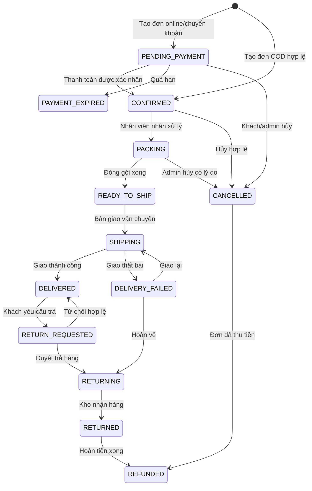
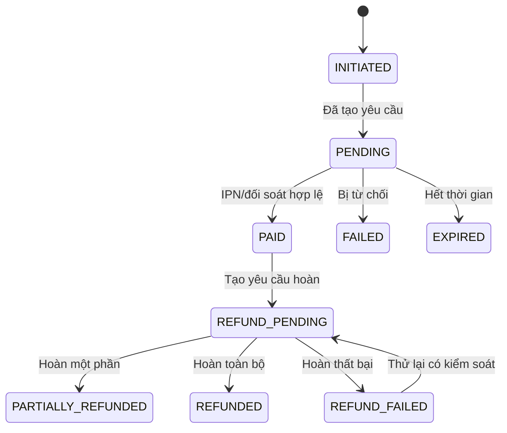
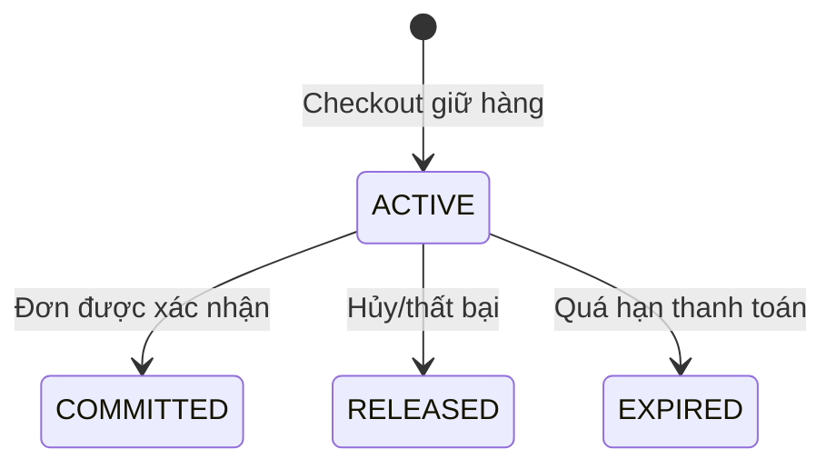

# 02 — State machine nghiệp vụ

## 1. Trạng thái đơn hàng



Quy tắc bắt buộc:

- Không chuyển ngược trạng thái tùy ý.
- Mọi lần chuyển trạng thái lưu history, actor, lý do và thời gian.
- Khách chỉ hủy `PENDING_PAYMENT` hoặc `CONFIRMED` khi chưa đóng gói.
- Đơn online không vào `PACKING` khi payment chưa `PAID`.
- Hủy/expire phải giải phóng reservation đúng một lần.
- `DELIVERED` không hủy; dùng quy trình return/refund.

## 2. Trạng thái thanh toán



- Mỗi order có thể có nhiều payment attempt nhưng chỉ một tổng số tiền thành công hợp lệ.
- Giao dịch VNPay được unique theo provider transaction number và merchant reference.
- Callback có checksum sai chỉ ghi security log, không đổi payment/order.
- Return URL không được chuyển payment sang `PAID`.

## 3. Trạng thái giữ tồn



- `ACTIVE` làm tăng reserved, không giảm on-hand.
- `COMMITTED` giảm on-hand và reserved trong cùng transaction.
- `RELEASED/EXPIRED` chỉ giảm reserved.

## 4. Trạng thái vận chuyển

```text
NOT_CREATED → CREATED → PICKUP_SCHEDULED → PICKED_UP
→ IN_TRANSIT → DELIVERED

Nhánh lỗi:
CREATED/PICKUP_SCHEDULED → CANCELLED
IN_TRANSIT → DELIVERY_FAILED → IN_TRANSIT | RETURNING
RETURNING → RETURNED
```

Trạng thái từ GHN/GHTK/Viettel Post phải map vào enum nội bộ; không lưu enum phụ thuộc trực tiếp nhà cung cấp vào order.

## 5. Trạng thái bài viết

```text
DRAFT → IN_REVIEW → SCHEDULED → PUBLISHED → ARCHIVED
  ↑         │             │          │
  └─────────┴─────────────┴──────────┘ (trả về nháp khi có quyền)
```

- Editor: `DRAFT`, `IN_REVIEW`.
- Publisher/Admin: duyệt, lên lịch, xuất bản, gỡ bài.
- Job xuất bản theo lịch phải idempotent.

