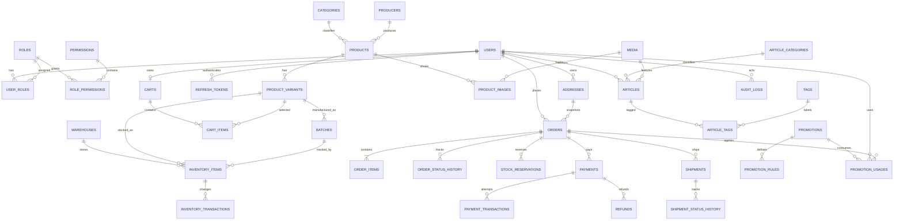

# 03 — ERD và data dictionary

## 1. ERD mức domain

## 2. Chuẩn chung

- Primary key: `BIGINT` hoặc UUID/ULID thống nhất; API không phụ thuộc ID tuần tự có thể đoán.
- Tiền: `DECIMAL(19,2)`; tiền VNĐ được làm tròn theo chính sách hệ thống.
- Thời gian: UTC, `TIMESTAMP(6)`.
- Chuỗi tiếng Việt: `utf8mb4`.
- Bảng thay đổi thường xuyên có `version` để optimistic locking.
- Master data có `created_at`, `updated_at`, `created_by`, `updated_by`, `deleted_at` khi cần soft delete.
- Index mọi foreign key và trường tìm kiếm/lọc phổ biến.

## 3. Bảng cốt lõi

### Identity

| Bảng | Trường quan trọng | Ràng buộc |
|---|---|---|
| `users` | id, email, password_hash, full_name, phone, status, age_confirmed_at | email unique; password chỉ lưu hash |
| `roles` | id, code, name | code unique |
| `permissions` | id, code, description | code unique |
| `user_roles` | user_id, role_id | unique cặp |
| `role_permissions` | role_id, permission_id | unique cặp |
| `refresh_tokens` | token_hash, user_id, expires_at, revoked_at, family_id | không lưu raw token |
| `addresses` | user_id, receiver_name, phone, province/district/ward codes, detail, is_default | chỉ owner truy cập |

### Catalog và kho

| Bảng | Trường quan trọng | Ràng buộc |
|---|---|---|
| `categories` | name, slug, status, sort_order | slug unique |
| `producers` | name, legal_name, origin, contact | soft delete |
| `products` | category_id, producer_id, name, slug, description, status, seo_* | slug unique |
| `product_variants` | product_id, sku, barcode, volume_ml, alcohol_percent, price, compare_price, weight_gram, status | sku unique; price >= 0 |
| `media` | url, storage_key, mime_type, width, height, alt_text, checksum | storage_key unique |
| `product_images` | product_id, media_id, sort_order, is_primary | một primary/product |
| `batches` | variant_id, batch_code, manufactured_at, expires_at, origin_note | batch_code unique theo variant |
| `warehouses` | code, name, address, status | code unique |
| `inventory_items` | warehouse_id, variant_id, batch_id, on_hand, reserved, version | unique warehouse+variant+batch; reserved <= on_hand |
| `inventory_transactions` | inventory_item_id, type, quantity, reference_type/id, before_qty, after_qty | append-only |
| `stock_reservations` | order_id, inventory_item_id, quantity, status, expires_at | index status+expires_at |

### Bán hàng

| Bảng | Trường quan trọng | Ràng buộc |
|---|---|---|
| `carts` | user_id, status, expires_at | tối đa một ACTIVE/user |
| `cart_items` | cart_id, variant_id, quantity | unique cart+variant; quantity > 0 |
| `orders` | order_number, user_id, status, payment_status, subtotal, discount_total, shipping_fee, grand_total, address_snapshot, version | order_number unique |
| `order_items` | order_id, variant_id, sku_snapshot, name_snapshot, volume_snapshot, unit_price, discount, quantity, line_total | dữ liệu snapshot |
| `order_status_history` | order_id, from_status, to_status, actor_id, reason, occurred_at | append-only |
| `payments` | order_id, method, status, amount, paid_at, version | index order+status |
| `payment_transactions` | payment_id, provider, merchant_ref, provider_txn_no, request_id, amount, status, raw_reference | unique provider+provider_txn_no; merchant_ref unique theo provider |
| `refunds` | payment_id, amount, reason, status, provider_ref | tổng refund <= paid amount |
| `shipments` | order_id, provider, service_code, tracking_code, fee, status, label_url | tracking unique khi có |
| `shipment_status_history` | shipment_id, provider_status, internal_status, occurred_at | append-only |

### Nội dung và vận hành

| Bảng | Trường quan trọng | Ràng buộc |
|---|---|---|
| `promotions` | code, type, value, starts_at, ends_at, usage_limit, per_user_limit, combinable, status | code unique |
| `promotion_rules` | promotion_id, rule_type, operator, value_json | validate theo rule type |
| `promotion_usages` | promotion_id, user_id, order_id, amount | unique promotion+order |
| `articles` | author_id, category_id, featured_media_id, title, slug, excerpt, content, status, published_at, seo_* | slug unique |
| `article_categories` | name, slug | slug unique |
| `tags` | name, slug | slug unique |
| `article_tags` | article_id, tag_id | unique cặp |
| `audit_logs` | actor_id, action, entity_type/id, before_json, after_json, trace_id, created_at | append-only, không chứa secret |
| `idempotency_records` | key, user_id, operation, request_hash, response_code/body, expires_at | unique user+operation+key |

## 4. Migration và dữ liệu môi trường

- `V1__baseline.sql` tạo schema nền.
- Migration chỉ tiến về trước, không sửa file đã chạy ở môi trường chung.
- Production migration không chứa sản phẩm, tài khoản hoặc đơn mẫu.
- Role/permission hệ thống có thể là reference data bắt buộc, nhưng tài khoản admin đầu tiên được tạo bằng quy trình bootstrap an toàn, buộc đổi mật khẩu.
- Test data nằm trong test fixture/Testcontainers, không nằm trong `src/main/resources/db/migration`.

